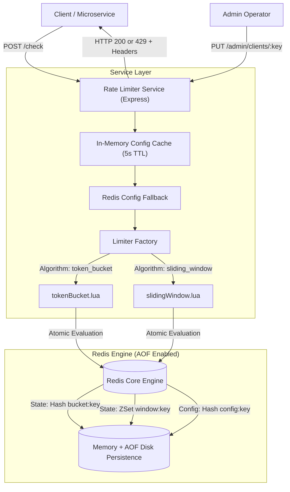

# Token Bucket & Sliding Window Rate Limiter Service

[](https://github.com/GyandeepEkansh/rate-limiter-service/actions/workflows/ci.yml)

A standalone, high-performance distributed HTTP rate limiter service built with **Node.js**, **Express**, and **Redis**. It provides atomic rate limit evaluations (`ALLOW` or `DENY`) across microservices with strict concurrency guarantees and persistent configuration.

---

## Architecture Overview



---

## Key Features

- **Strict Lua Script Atomicity**: Eliminates Time-Of-Check to Time-Of-Use (TOCTOU) race conditions by executing all reads, math, refills, decrements, and expirations inside a single atomic Redis Lua script.
- **Server Clock Synchronization**: Uses `redis.call('TIME')` inside Lua scripts rather than Node.js application clocks, preventing distributed clock skew across replicas. The `X-RateLimit-Reset` header is computed directly from Redis time.
- **In-Memory LRU Config Caching**: Caches client rate limit configurations in memory with a 5-second TTL and a 10,000-entry LRU eviction cap to prevent unbounded memory growth from random keys. Cuts Redis network round-trips by ~50% under heavy traffic.
  - *Trade-Off*: In multi-replica deployments, Admin API updates take up to 5s to propagate across other instances (eventual consistency), while the handling instance invalidates its local cache immediately.
- **Dual Algorithm Support**:
  1. **Token Bucket**: Ideal for sustained throughput with burst tolerance and smooth token refilling.
  2. **Sliding Window Log (Sorted Set)**: Rolling window guarantee preventing the 2x boundary burst exploit common in fixed-window algorithms.
- **Dynamic Per-Client Configuration**: Override default limits dynamically via authenticated Admin APIs without restarting the service. Cleanly overwrites hash keys to prevent stale configuration fields.
- **Configurable Fault Tolerance (Fail-Closed / Fail-Open)**:
  - **Default (Fail-Closed)**: Returns `503 Service Unavailable` if Redis is unreachable, protecting downstream microservices from overload.
  - **Fail-Open Mode**: Set `FAIL_OPEN=true` in `.env` to allow traffic through with `X-RateLimit-Fallback: true` for availability-first architectures.
- **AOF Disk Persistence**: Redis configured with `--appendonly yes` and Docker volume mounts to ensure client configs and bucket states survive crashes and restarts.
- **Production Hardened**: Runs as non-root user (`USER node`) in Docker, disables `x-powered-by`, and enforces non-default admin API keys in production.

---

## Algorithms Explained

### 1. Token Bucket (`token_bucket`)

Each client has a bucket configured with `burst` (maximum capacity) and `rate` (tokens refilled per second). State is stored in a Redis hash: `bucket:{key}` (`tokens`, `last_refill`).

```text
elapsed = max(0, now - last_refill)
tokens = min(burst, tokens + elapsed * rate)
```

- If `tokens >= 1`: Subtract 1 token, return `ALLOW`.
- If `tokens < 1`: Return `DENY` with:
  ```text
  retry_after = (1 - tokens) / rate (seconds)
  ```
- Updates `tokens` and `last_refill = now`.
- Automatically sets key expiration (`max(60, ceil(2 * burst / rate))`) to clean up idle clients.

---

### 2. Sliding Window Log (`sliding_window`)

Each client has a `limit` (max requests) and a rolling window `window_ms`. State is stored in a Redis sorted set: `window:{key}` where `score` is the timestamp and `member` is a unique request UUID.

1. **Purge old entries**:
   `ZREMRANGEBYSCORE key 0 (now - window_ms)`
2. **Count remaining requests in current window**:
   `count = ZCARD key`
3. **If `count < limit`**:
   Add entry `ZADD key now unique_id`, return `ALLOW`.
4. **If `count >= limit`**:
   Fetch oldest entry in the window via `ZRANGE key 0 0 WITHSCORES`.
   Compute exact retry delay:
   ```text
   retry_after = ((oldest_timestamp + window_ms) - now) / 1000
   ```
5. **Set key expiry**:
   Sets TTL on the sorted set via `PEXPIRE key window_ms`.

---

## Why Lua Atomicity Prevents Race Conditions

### The Naive JavaScript Flaw (TOCTOU)
In a naive Node.js implementation:
```text
Client A: HGETALL bucket:key (sees 1 token)
Client B: HGETALL bucket:key (sees 1 token before Client A writes back!)
Client A: HMSET bucket:key tokens=0 (allowed)
Client B: HMSET bucket:key tokens=0 (allowed - double spend!)
```
When tested with 100 concurrent requests with `burst = 10` and `rate = 0`, a naive implementation permits **all 100 requests**.

### Live Verification Script
You can demonstrate this race condition live by running:
```bash
npm run demo:race
```
Output:
```text
[Test 1] Firing 100 parallel requests against NAIVE implementation...
  --> Naive Allowed : 100 (Expected: 10)
  --> Naive Denied  : 0   (Expected: 90)
  [!] RACE CONDITION CONFIRMED: Allowed 90 extra requests due to read-then-write lag!

[Test 2] Firing 100 parallel requests against ATOMIC LUA implementation...
  --> Atomic Allowed: 10  (Expected: 10)
  --> Atomic Denied : 90  (Expected: 90)
  [✓] ATOMICITY CONFIRMED: Exactly 10 requests allowed, 90 denied.
```

---

## Verifying State Persistence Across Restarts

All bucket states and custom client configurations are backed by Redis Append-Only File (`--appendonly yes`) persistence mounted to `redis-data:/data`.

### Method A: Automated Verification Script
Run the included verification script:
```bash
node scripts/verify-persistence.js
```

### Method B: Manual Step-by-Step Proof
1. **Set a custom client configuration**:
   ```bash
   curl -X PUT http://localhost:3000/admin/clients/persist-test \
     -H "Content-Type: application/json" \
     -H "x-admin-key: admin-secret-key-123" \
     -d '{"algorithm": "token_bucket", "burst": 50, "rate": 5}'
   ```
2. **Consume 1 token**:
   ```bash
   curl -X POST http://localhost:3000/check -H "Content-Type: application/json" -d '{"key": "persist-test"}'
   # Returns: {"allowed":true,"remaining":49,"limit":50}
   ```
3. **Restart the Redis container**:
   ```bash
   docker compose restart redis
   ```
4. **Confirm data survived**:
   ```bash
   curl -X GET http://localhost:3000/admin/clients/persist-test -H "x-admin-key: admin-secret-key-123"
   # Returns stored burst: 50, rate: 5 intact!
   ```

---

## API Reference

### 1. Check Rate Limit
Checks if a request should be allowed for a client key.

```bash
POST /check
Content-Type: application/json

{
  "key": "client-123"
}
```

#### Success Response (`HTTP 200 OK`)
```json
{
  "allowed": true,
  "remaining": 19,
  "limit": 20
}
```

#### Denied Response (`HTTP 429 Too Many Requests`)
```json
{
  "allowed": false,
  "retry_after": 1.85,
  "remaining": 0,
  "limit": 20
}
```

#### Response Headers:
- `X-RateLimit-Limit`: Maximum burst/limit
- `X-RateLimit-Remaining`: Tokens/requests remaining
- `X-RateLimit-Reset`: Unix epoch seconds (synchronized with Redis clock)
- `Retry-After`: Seconds to wait before retrying (on 429)

---

### 2. Set Client Configuration (Admin API)
Configures custom rate limiting parameters for a specific client key. Overwrites existing configuration to prevent field pollution across algorithm switches.

```bash
curl -X PUT http://localhost:3000/admin/clients/vip-service \
  -H "Content-Type: application/json" \
  -H "x-admin-key: admin-secret-key-123" \
  -d '{"algorithm": "token_bucket", "rate": 50, "burst": 100}'
```

---

### 3. Health Check
```bash
curl -X GET http://localhost:3000/health
```

---

## Running with Docker

```bash
docker compose up -d
```

---

## Automated Tests

### 1. Fast Local Unit & Concurrency Tests
Run the mock-based test suite for quick, zero-dependency local development (no Docker or external Redis required):

```bash
npm test
```

### 2. Live Redis Integration Tests
Verify atomicity and concurrency against an actual running Redis instance (`localhost:6379`):

```bash
npm run test:integration
```

### 3. GitHub Actions CI
Every commit and pull request runs automated tests and the race condition verification against an active `redis:7-alpine` container on Ubuntu via `.github/workflows/ci.yml`.

---

## Load Testing Benchmarks

### Running the Benchmark
```bash
npm run benchmark
```
*(Or via k6: `k6 run load-test/check.js`)*

### Measured Benchmark Results (20-Second Sustained Load)

Benchmark measured against **Redis 7 in Docker** (`docker compose up -d redis`):

| Metric | Target | Actual Measured Result |
| :--- | :--- | :--- |
| **Duration** | 20 seconds | **20.00 s** |
| **Total Requests** | High concurrency | **62,312 requests** |
| **Measured Throughput**| $\ge 500$ req/s | **3,115.3 req/s** |
| **Allowed (200 OK)** | — | **11,140** |
| **Denied (429 Limit)** | — | **51,172** |
| **Latency (p50)** | < 10 ms | **5.85 ms** |
| **Latency (p95)** | < 20 ms | **9.28 ms** |
| **Latency (p99)** | < 50 ms | **12.62 ms** |
| **Server Error Rate** | 0% | **0.00% (0 errors)** |
| **Hot Key Correctness**| $\le B + (R \times T) = 220$ | **219 Allowed (100% compliant, 0% leakage)** |
